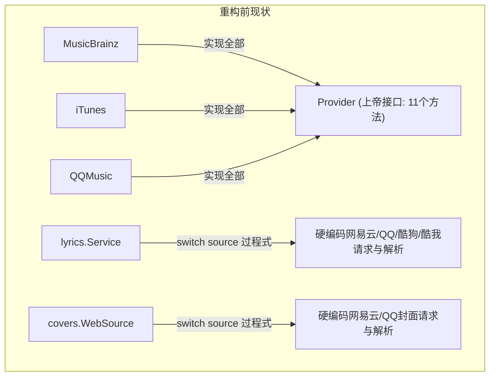

# 上游解耦与能力化重构架构设计分析

## 1. 背景与现状诊断

在当前实现中，业务包（如 `internal/lyrics`、`internal/covers`）存在大量针对不同上游平台的差异化处理代码：
- `internal/lyrics/service.go` 与 `search.go`：通过多层 `switch source` 分别针对 `"163"`、`"qq"`、`"kugou"`、`"kuwo"` 构造专有请求、加解密（WEAPI）、设置 Header/Referer 并手写响应解析。
- `internal/covers/sources/web.go`：通过 `switch s.ID` 针对 QQ 和网易云分别构造私有请求体、处理字段差异和解析逻辑。
- `internal/provider/qqmusic` 与 `covers`、`lyrics` 之间：同一平台的端点调用（如 `musicu.fcg`、歌词接口）被多处重复维护，错误码判断出现规则漂移。

**核心根因分析**：
最开始的设计采用了单体大 `Provider` 接口（声明在 `internal/provider/provider.go`），包含了音轨搜索、详情、快照、元数据能力和封面搜索等 11 个方法。然而现实中各上游的能力高度异构且非对称：
- **酷狗、酷我**：仅提供歌词接口，不提供专辑与音轨匹配等全量元数据。
- **网易云**：目前只提供封面与歌词能力，未接入元数据快照流程。
- **CAA（Cover Art Archive）**：仅提供基于 MusicBrainz 发行版 ID 的封面，无歌词和通用搜索能力。
- **iTunes**：提供元数据和封面，不提供歌词。
- **MusicBrainz**：提供核心元数据，无独立封面（依赖 CAA），无歌词。

因为“单一上游接口”强求全量能力，部分能力单一的上游无法成为正规 Provider，导致开发者只能在业务包内使用 `switch source` 越俎代庖处理协议差异。

---

## 2. 问题解答与深度分析

### 2.1 问题一：我们是否应该采用“业务包声明消费端接口 + Provider 包中按能力实现相关接口 + 依赖注入”？

**结论：坚决支持，且这是 Go 语言最推崇的经典设计模式（Consumer-driven Interfaces）。**

#### 架构优势与设计原则支撑
1. **符合 Go 语言的接口哲学（Idiomatic Go）**
   - Go 语言通过结构化类型（Structural Typing / Duck Typing）实现隐式接口，官方核心指导原则是：“**接口由消费者（使用者）定义，而不是生产者定义**（Accept interfaces, return structs）”。
   - 业务包（如 `lyrics`）最清楚自己需要什么数据（搜索词、候选列表、正文文本），由业务包定义接口规范输入与输出；具体上游包只需提供符合签名的方法即可，无需显式声明依赖哪个业务包。
2. **满足接口隔离原则（ISP）与开闭原则（OCP）**
   - **重构前**：新增一个上游（例如接入网易云歌词），需要改动 `lyrics/service.go` 的 4 处 `switch` 分支，修改核心业务文件，极易引入回归。
   - **重构后**：新增上游只需在对应上游包中实现 `lyrics.Provider` 接口，并在启动装配时注册到依赖列表中。业务包的搜索、获取、缓存、乐观锁代码**零改动**。
3. **满足依赖倒置原则（DIP）**
   - 高层业务策略（如歌词会话控制、格式转换、时间戳合并）不依赖低层外部协议细节（如 QQ 的 JSONP 剥离、网易云的 AES-CBC 模幂加密）。
   - 上游实现包作为适配器（Adapter），负责将异构的外部协议转换为业务包声明的纯粹领域模型（DTO）。

#### 落地关键约束与避坑指南
- **底层共享基础设施必须保持全局单例**：
  QQ 音乐和网易云同时服务于“封面”和“歌词”。重构为能力接口后，**底层的网络传输（`provider.Client`）、限流令牌桶（`provider.Limiters`）、出网门禁（`Gate`）必须是全局单例共享的**。不能因为上层分成了歌词接口和封面接口，导致网易云歌词和封面各自建一个限流器把上游打封。
- **单向依赖防成环（No Import Cycles）**：
  - 依赖方向为：`app (装配层)` -> `provider/xxx (具体实现)` -> `lyrics / covers (业务接口与领域模型)`。
  - `lyrics` 和 `covers` 业务包**绝对不能 import 任何具体上游包**（例如不能 import `provider/qqmusic` 或 `provider/netease`）。

---

### 2.2 问题二：当前 Provider 接口有什么作用？

当前 `internal/provider/provider.go` 中定义的 `Provider` 接口，其本质**不是通用的外部平台抽象，而是专职的“整轨音乐元数据与发行版提供商”（Track/Release Metadata Provider）**。

其在现有系统中的实际职责包括：

1. **音乐库全量导入与曲目匹配（Import & Matching）**
   - 关键方法：`SearchTracks()`, `FetchDetail()`, `Refs()`
   - 作用：导入本地音频时，由 `importer.Runner` 和 `matching.Engine` 调用，在 MusicBrainz 等元数据源上搜索匹配候选，拉取发行版（Release）及完整曲目清单（Tracklist）。
2. **多源元数据补全与快照同步（Enrichment & Snapshot Sync）**
   - 关键方法：`SnapshotFromCandidate()`, `Complete()`, `LoadReleaseSummary()`
   - 作用：构建版本快照（`domain.Snapshot`），驱动专辑详情抽屉、艺术家归属及当前版本的多上游合并。
3. **元数据字段能力协商（Schema & UI Column Policy）**
   - 关键方法：`Capabilities()`
   - 作用：声明该上游支持哪些元数据字段（如 `CapComposer`, `CapISRC`, `CapLabel`, `CapCountry` 等），驱动前端表格动态显示或隐藏特定列（`registry.CapabilitiesOf`）。
4. **上游标识与限流元信息**
   - 关键方法：`ID()`, `DisplayName()`, `RateLimit()`, `IsConfigured()`
   - 作用：在设置页和全局注册表里统一展示可用上游、配置并发速率、检测是否联网可用。
5. **历史遗留的封面搜索**
   - 接口方法：`SearchCovers(ctx, q) ([]CoverGroup, error)`
   - 状态：在此前的封面搜索重构后，`covers` 业务包已转向了独立的 `sources.Searcher`（自建了 `CAASource`、`ITunesSource`、`WebSource`），核心流程已不再直接调用 `Provider.SearchCovers`。

---

### 2.3 问题三：如果采用新设计，Provider 接口要怎么办？是保留部分，还是直接取消？

**推荐做法：不建议彻底取消，也不建议保留现状，而是进行“职责降级与拆分”。**

建议将接口体系重构为**三层**：

#### 1. 提取最基础的通用元信息接口：`Upstream`（基础设施层）
所有第三方平台（不论是只做歌词的酷狗、做封面的 CAA，还是全功能的 MusicBrainz）都具备的公共基础信息：
```go
package provider

type Upstream interface {
    ID() ProviderID
    DisplayName() string
    RateLimit() (n int, per time.Duration)
    IsConfigured() error
}
```
*作用：供 `App` 的网络调度器初始化统一的限流桶、给前端设置页面列出可用平台列表。*

#### 2. 将原有的 `Provider` 接口瘦身并明确命名为 `MetadataProvider`（元数据领域）
保留其在匹配、导入、快照构建中的核心地位，但剔除不属于元数据领域的方法：
```go
type MetadataProvider interface {
    Upstream
    Capabilities() Capabilities
    Refs() RefCodec
    SearchTracks(ctx context.Context, q Query) ([]Candidate, error)
    FetchDetail(ctx context.Context, ref Ref) (*Detail, error)
    SnapshotFromCandidate(Candidate) (*domain.Snapshot, error)
    Complete(context.Context, domain.DetailTarget) (*domain.Snapshot, error)
    LoadReleaseSummary(context.Context, domain.ReleaseIdentity) (*domain.ReleaseSummary, error)
    // 彻底删除 SearchCovers！
}
```
*实现者：`musicbrainz`、`itunes`、`qqmusic`（均保留当前成熟的元数据实现）。酷狗、酷我、网易云无需实现它。*

#### 3. 各业务包定义专职的消费端接口（业务领域层）

- **在 `internal/lyrics` 包中**：
  ```go
  package lyrics

  type Provider interface {
      ID() string
      DisplayName() string
      SearchLyrics(ctx context.Context, q Query) ([]Candidate, error)
      FetchLyric(ctx context.Context, c Candidate) (*Document, error)
  }
  ```
  在 `internal/provider/qqmusic`、`internal/provider/netease`、`internal/provider/kugou`、`internal/provider/kuwo` 中各自实现上述方法。
  `lyrics.Service` 初始化时只接收 `[]lyrics.Provider` 注册切片，内部用 `map[string]Provider` 分发，彻底告别 `switch source`。

- **在 `internal/covers` 包中**：
  ```go
  package covers

  type Provider interface {
      ID() string
      DisplayName() string
      SearchCovers(ctx context.Context, q Query) ([]CoverCandidate, error)
  }
  ```
  `caa`、`itunes`、`qqmusic`、`netease` 分别作为独立的封面提供者接入。

---

## 3. 架构演进全景图

### 重构前：上帝接口 + 业务硬编码适配


### 重构后：能力接口隔离 + 依赖注入
```mermaid
graph TD
    subgraph 业务层 (定义接口)
        Meta["MetadataProvider (元数据接口)"]
        Cov["covers.Provider (封面接口)"]
        Lyr["lyrics.Provider (歌词接口)"]
    end

    subgraph 上游实现层 (按能力实现)
        MB[MusicBrainz] -.->|实现| Meta
        CAA[CAA Archive] -.->|实现| Cov
        IT[iTunes] -.->|实现| Meta
        IT -.->|实现| Cov
        QQ[QQ Music] -.->|实现| Meta
        QQ -.->|实现| Cov
        QQ -.->|实现| Lyr
        NE[网易云] -.->|实现| Cov
        NE -.->|实现| Lyr
        KG[酷狗] -.->|实现| Lyr
        KW[酷我] -.->|实现| Lyr
    end

    subgraph 共享基础设施层
        Client[provider.Client 共享网络/重试/门禁]
        Limiters[provider.Limiters 平台级限流桶]
    end

    MB & CAA & IT & QQ & NE & KG & KW --> Client
    MB & CAA & IT & QQ & NE & KG & KW --> Limiters
```

---

## 4. 实施路线图建议

为了保证重构过程可控且不破坏已有功能，建议按以下四阶段平滑推进：

1. **第一阶段：歌词模块先行解耦（收益最高、风险最低）**
   - 在 `internal/lyrics` 中定义小型 `Provider` 接口。
   - 将网易云、QQ、酷狗、酷我的请求构造与解析代码从 `lyrics/service.go` 和 `search.go` 抽取到各自的 provider 适配包中。
   - `lyrics.Service` 改为依赖注入的驱动器，彻底消除 `lyrics` 包内的 `switch source`。
2. **第二阶段：共享协议层收敛**
   - 提取 QQ 音乐和网易云的基础协议（歌曲搜索、详情、加解密），让封面、歌词与元数据共用同一套底层客户端，避免规则漂移。
   - 统一限流桶标识（按平台而非按功能命名，例如统一使用 `provider.QQMusic`、`provider.NetEase`）。
3. **第三阶段：封面模块对齐新架构**
   - 将 `covers/sources/web.go` 中的网易云和 QQ 封面适配逻辑移入对应上游包。
   - 封面业务同样面向 `covers.Provider` 接口编程。
4. **第四阶段：Provider 瘦身与正名**
   - 从 `provider.Provider` 中剔除 `SearchCovers`。
   - 重命名或精确定位为 `MetadataProvider`，完善元数据提供商契约。
